<p align="center">
  <a href="https://uiset.dev">
    <picture>
      <source media="(prefers-color-scheme: dark)" srcset=".github/assets/banner-dark.webp">
      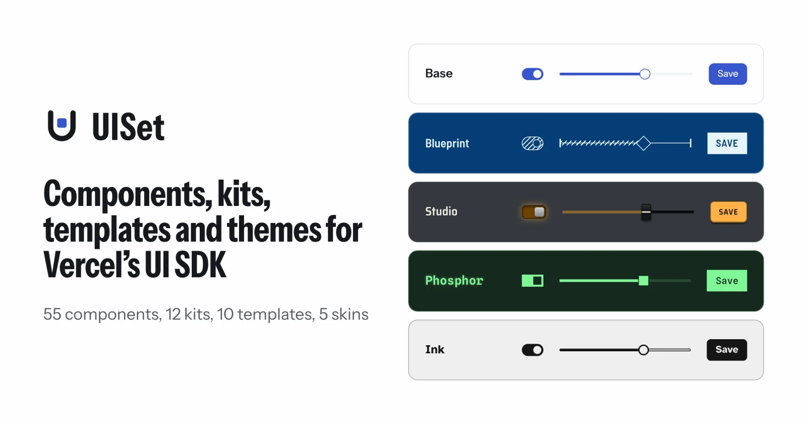
    </picture>
  </a>
</p>

<h3 align="center">Build the whole interface on UI SDK.</h3>

<p align="center">
  UISet is the components, kits, templates and themes for <a href="https://ui-sdk.dev">Vercel's UI SDK</a>.<br>
  UI SDK handles keyboard, focus, screen readers and agents. UISet adds how it looks,<br>
  the big components real apps need, and whole pages. Install any piece with the shadcn CLI.
</p>

<p align="center">
  <a href="https://uiset.dev"><b>uiset.dev</b></a> &nbsp;·&nbsp;
  <a href="https://uiset.dev/docs">Docs</a> &nbsp;·&nbsp;
  <a href="https://uiset.dev/components">Components</a> &nbsp;·&nbsp;
  <a href="https://uiset.dev/kits">Kits</a> &nbsp;·&nbsp;
  <a href="https://uiset.dev/templates">Templates</a> &nbsp;·&nbsp;
  <a href="https://uiset.dev/themes">Themes</a> &nbsp;·&nbsp;
  <a href="https://uiset.dev/agents">Agents</a>
</p>

<p align="center">
  <a href="LICENSE"></a>
  <a href="https://ui-sdk.dev"></a>
  <a href="https://uiset.dev/docs/installation"></a>
  <a href="https://www.npmjs.com/package/@uiset/web"></a>
  <a href="CONTRIBUTING.md"></a>
</p>

## UI SDK gives you behavior. UISet gives you everything else.

UI SDK moved the hard part of UI into reusable behaviors: arrow keys, focus, selection,
popups, drag and drop, and the ARIA that goes with them, plus a bridge that lets agents work
the controls. It ships its components unstyled, and it leaves the large ones to you. That's
where UISet starts.

<table>
  <tr>
    <th width="50%" align="left">UISet</th>
    <th width="50%" align="left">UI SDK, underneath</th>
  </tr>
  <tr>
    <td valign="top">
      <ul>
        <li><b>Looks:</b> five skins, a theme generator, sound and haptics</li>
        <li><b>55 styled components</b> and 29 app parts</li>
        <li><b>12 kits:</b> chat, rich text, data grid, charts, scheduler and more</li>
        <li><b>10 page templates</b> to start from</li>
        <li><b>Web Components</b> for Vue, Svelte, Solid and HTML</li>
        <li><b>A skill and llms.txt</b> for coding agents</li>
      </ul>
    </td>
    <td valign="top">
      <ul>
        <li><b>Behaviors:</b> keyboard, focus, selection, popups, drag and drop</li>
        <li><b>55 components</b>, unstyled</li>
        <li><b>The agent bridge</b> and WebMCP</li>
        <li><b>Five frameworks:</b> React, Vue, Svelte, Solid, Web Components</li>
      </ul>
    </td>
  </tr>
</table>

## Start in three steps

**1. Add the root.** It brings the tokens, the skins and the sound into your project's
components folder.

```bash
npx shadcn@latest add @uiset/uiset
```

**2. Wrap your app.** Every UISet and UI SDK component inside takes the skin. With a shadcn
theme on the page, the base skin uses it.

```tsx
import { UISet } from "@/components/ui/uiset"

export function App() {
  return <UISet skin="base">{/* your app */}</UISet>
}
```

**3. Add what you need.** Components, kits or a whole page, each with one command, and each
brings only what it uses.

```bash
npx shadcn@latest add @uiset/select @uiset/data-grid
```

The [installation guide](https://uiset.dev/docs/installation) covers fonts, the shadcn
theme, and installing by hand. The [quick start](https://uiset.dev/docs/quick-start) builds a
settings screen in a few minutes.

## Everything a product needs, in one set

Pick what you need: each item installs on its own and brings only what it uses. You never
mix in a second UI library.

<table>
  <tr>
    <td width="24%" valign="top"><a href="https://uiset.dev/components"><b>55 + 16 components</b></a></td>
    <td valign="top">Every UI SDK component, styled, plus the app frame and data display parts: sidebar layout, page header, cards, badges, stats, alerts.</td>
  </tr>
  <tr>
    <td width="24%" valign="top"><a href="https://uiset.dev/kits"><b>12 kits</b></a></td>
    <td valign="top">The big pieces apps need and UI SDK leaves to you: chat, rich text, a data grid, charts, a board, a scheduler, a canvas, an IDE, a terminal, mobile patterns, Studio and the Agent Console.</td>
  </tr>
  <tr>
    <td width="24%" valign="top"><a href="https://uiset.dev/templates"><b>10 templates</b></a></td>
    <td valign="top">Whole pages to start from: auth, dashboard, settings, admin, inbox, chat app, project board, calendar, pricing, IDE.</td>
  </tr>
  <tr>
    <td width="24%" valign="top"><a href="https://uiset.dev/themes"><b>5 skins</b></a></td>
    <td valign="top">Five skins you can switch live and nest, and a generator that turns one color into a complete, checked theme.</td>
  </tr>
</table>

## Kits you'd otherwise build yourself

These are the real components, running on [uiset.dev/kits](https://uiset.dev/kits). Each is
keyboard-first, readable by screen readers and agents, and styled by the skin around it.

<table>
  <tr>
    <td width="50%" valign="top">
      <a href="https://uiset.dev/kits#chat">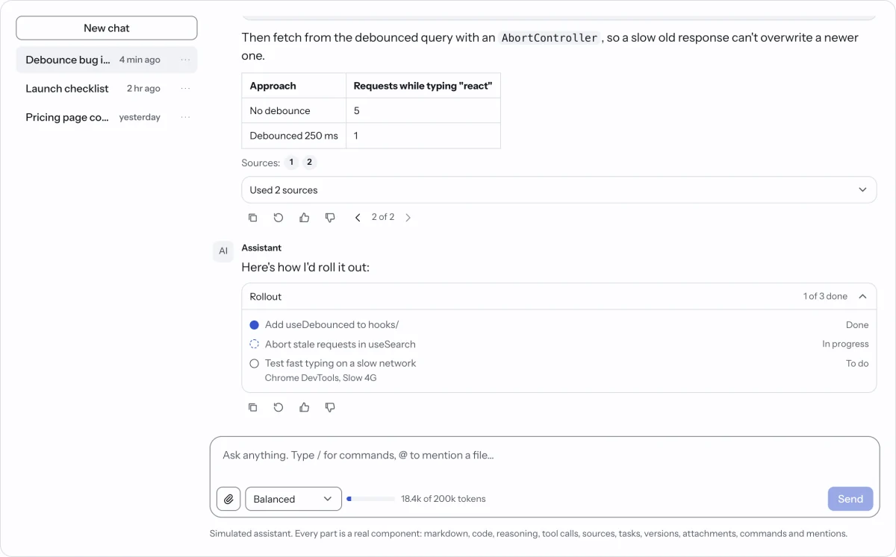</a>
      <p><b><a href="https://uiset.dev/docs/kits/chat">Chat</a></b><br>Streaming Markdown and code, reasoning, tool calls, sources, plans, versions, and a composer with attachments, commands and mentions. Plug in any model.</p>
    </td>
    <td width="50%" valign="top">
      <a href="https://uiset.dev/kits#data">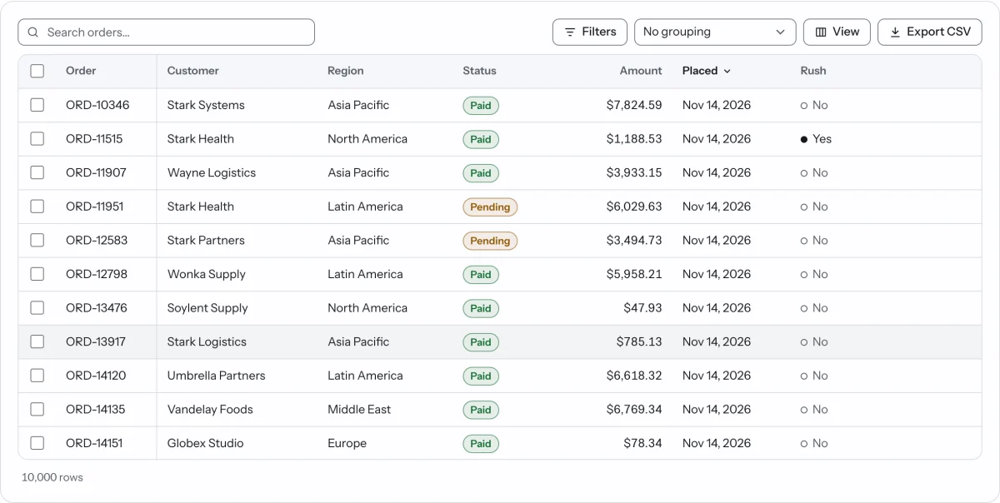</a>
      <p><b><a href="https://uiset.dev/docs/kits/data-grid">Data grid</a></b><br>Ten thousand rows drawn as you scroll. Sort, filter, group, pin, resize and reorder columns, edit in place, copy and paste blocks, export.</p>
    </td>
  </tr>
  <tr>
    <td width="50%" valign="top">
      <a href="https://uiset.dev/kits#writing">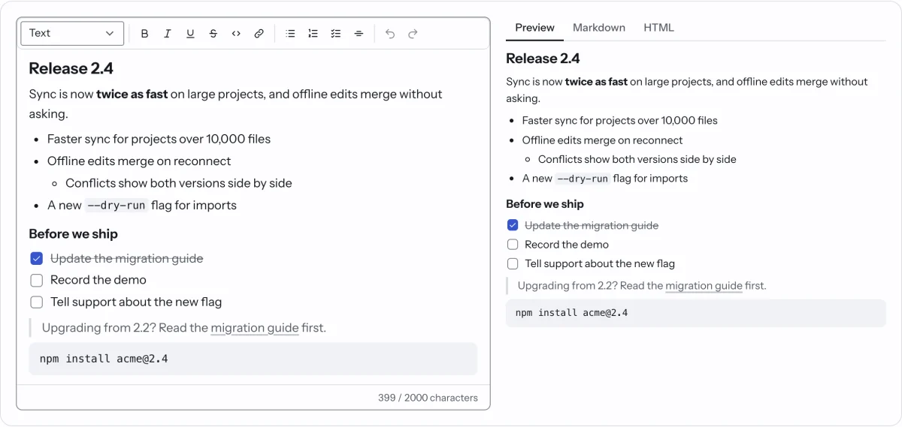</a>
      <p><b><a href="https://uiset.dev/docs/kits/rich-text">Rich text</a></b><br>Headings, lists, to-dos, quotes, code and links, Markdown as you type, "/" for blocks and "@" for people. Saves Markdown or HTML. No editor library underneath.</p>
    </td>
    <td width="50%" valign="top">
      <a href="https://uiset.dev/kits#charts">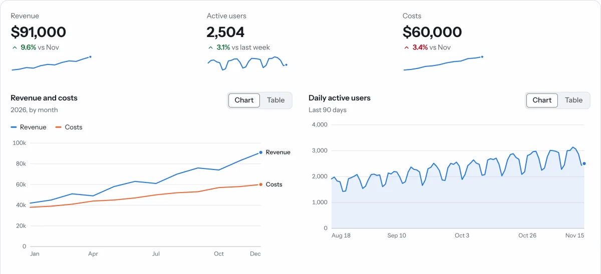</a>
      <p><b><a href="https://uiset.dev/docs/kits/charts">Charts</a></b><br>Lines, bars, areas, scatter, heatmaps and part-to-whole bars, with colors checked for color blindness. Arrow through the data or switch to a table.</p>
    </td>
  </tr>
  <tr>
    <td width="50%" valign="top">
      <a href="https://uiset.dev/kits#board">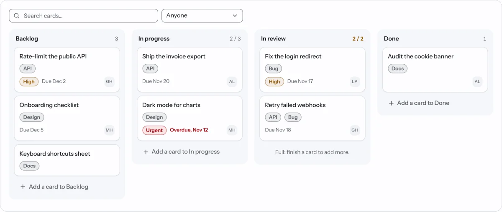</a>
      <p><b><a href="https://uiset.dev/docs/kits/board">Board</a></b><br>Columns with limits and cards that move by drag or by keys. Every move is announced and can be undone.</p>
    </td>
    <td width="50%" valign="top">
      <a href="https://uiset.dev/kits#scheduler">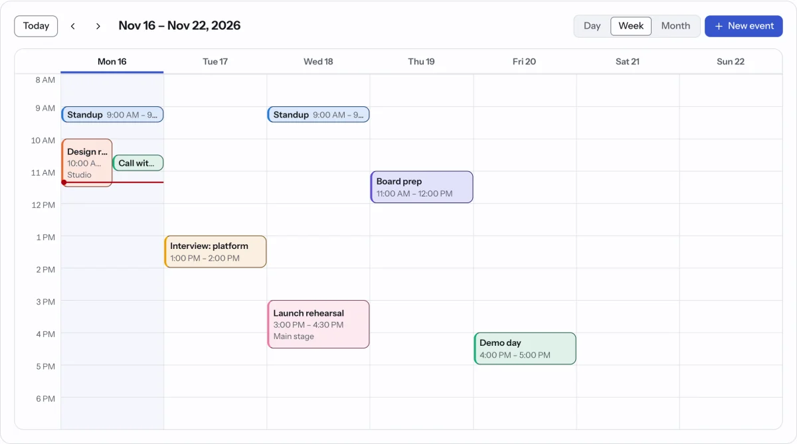</a>
      <p><b><a href="https://uiset.dev/docs/kits/scheduler">Scheduler</a></b><br>A week, a day, a month or a timeline of rooms. Draw, move and resize events with the pointer or the arrow keys.</p>
    </td>
  </tr>
  <tr>
    <td width="50%" valign="top">
      <a href="https://uiset.dev/kits#canvas">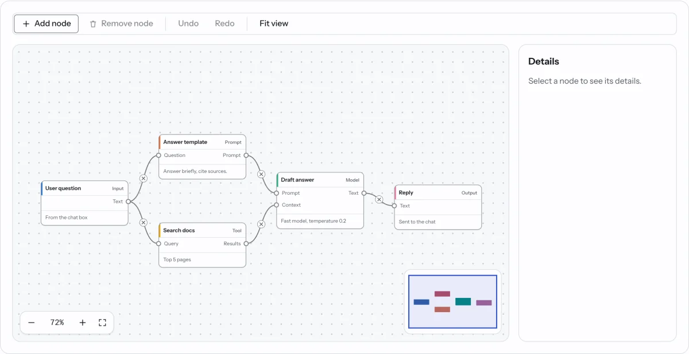</a>
      <p><b><a href="https://uiset.dev/docs/kits/canvas">Canvas</a></b><br>Pan and zoom, drag nodes, connect ports, lasso, a minimap and undo. Every node and port is reachable from the keyboard.</p>
    </td>
    <td width="50%" valign="top">
      <a href="https://uiset.dev/kits#ide">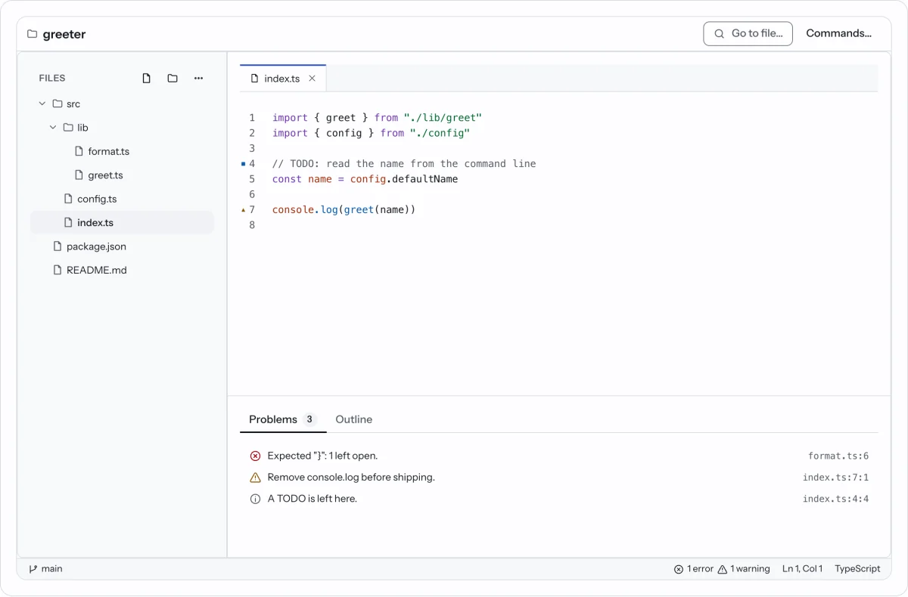</a>
      <p><b><a href="https://uiset.dev/docs/kits/ide">IDE</a></b><br>A file tree, tabs, a code editor with syntax colors, a command palette, problems, an outline and a status bar, in resizable panes.</p>
    </td>
  </tr>
  <tr>
    <td width="50%" valign="top">
      <a href="https://uiset.dev/kits#terminal">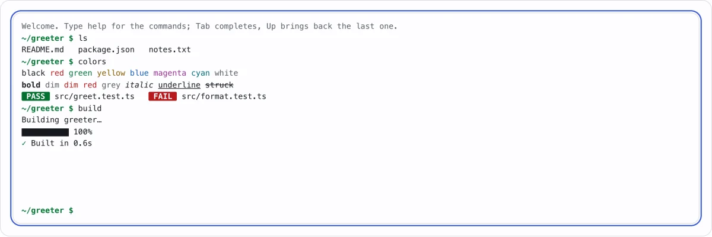</a>
      <p><b><a href="https://uiset.dev/docs/kits/terminal">Terminal</a></b><br>ANSI colors kept readable in every skin, links, streaming output with progress lines, Tab completion and history.</p>
    </td>
    <td width="50%" valign="top">
      <a href="https://uiset.dev/kits#mobile">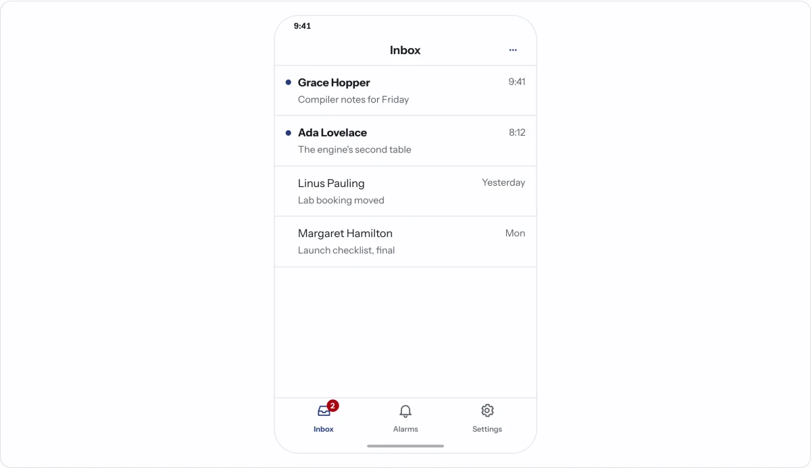</a>
      <p><b><a href="https://uiset.dev/docs/kits/mobile">Mobile</a></b><br>Rows that swipe aside to actions, wheel pickers, bottom sheets and action sheets, pull to refresh, an app bar and a tab bar.</p>
    </td>
  </tr>
  <tr>
    <td width="50%" valign="top">
      <a href="https://uiset.dev/kits?skin=studio#studio">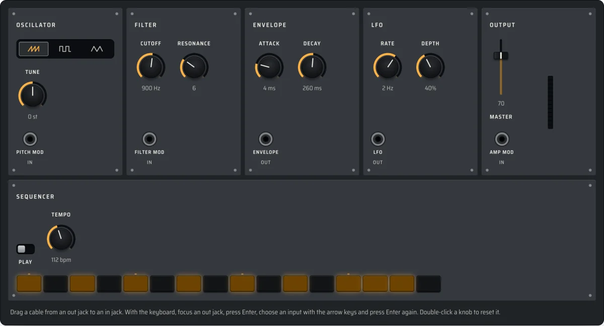</a>
      <p><b><a href="https://uiset.dev/docs/kits/studio">Studio</a></b><br>Knobs, a fader, a level meter, a step sequencer and a patch bay that play real sound. Every control works from the keyboard.</p>
    </td>
    <td width="50%" valign="top">
      <a href="https://uiset.dev/agents#agents">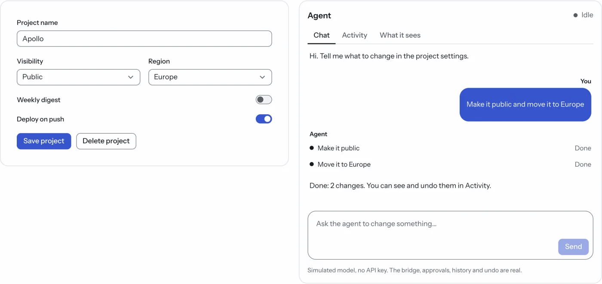</a>
      <p><b><a href="https://uiset.dev/docs/kits/agent-console">Agent Console</a></b><br>Let an agent work in your app and stay in charge: approvals for risky steps, an activity log, undo, and what the agent sees.</p>
    </td>
  </tr>
</table>

## Five skins, one set of components

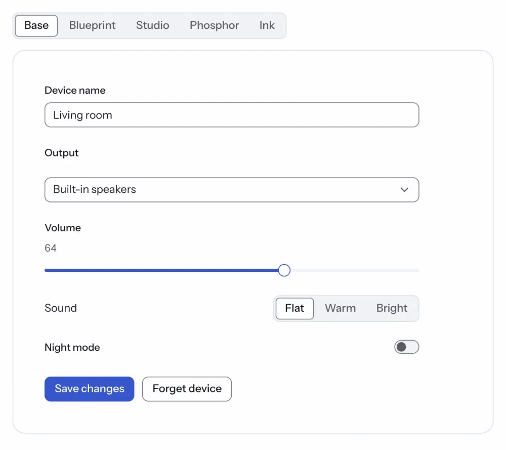

A skin changes how everything looks, sounds and feels. Behavior never changes: the same
keyboard, focus and screen reader experience in every one. Skins nest, so a panel can wear
its own.

- **Base:** adopts the shadcn/ui theme on your page, builds one from a key color, or is black and white. Light and dark.
- **Blueprint:** a technical drawing, with cyanotype paper, white linework and hatching.
- **Studio:** a rack of synth modules, gunmetal faceplates and amber lamps. It sounds mechanical.
- **Phosphor:** a monochrome video terminal, with a faint bloom and scan lines. It beeps.
- **Ink:** electronic paper, a reading serif for long text, and no motion at all.

Every skin is checked at 4.5:1 for text and 3:1 for controls and focus, in each theme it has.

The **[theme generator](https://uiset.dev/themes/generator)** turns one key color into a
complete theme for light and dark, checks every pair, fixes what fails with one click, and
exports a UISet skin, shadcn/ui variables or W3C design tokens.

<br clear="right">

<p align="center">
  <a href="https://uiset.dev/themes/generator">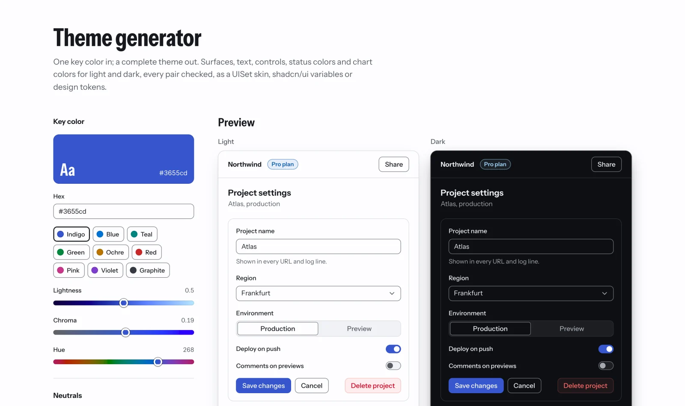</a>
</p>

## Agents can use it, not just look at it

Every control is named for UI SDK's agent bridge, so an agent reads the page as data and
works the controls directly, with no screenshots. Risky steps wait for a person in the
Agent Console, and every change can be undone.

We ran UI SDK's comparison on UISet's own kits: the same tasks, done by an agent with browser
tools (a page snapshot, click, type) and by an agent with the bridge (snapshot, act, query).
Across three tasks, **the bridge took 40% fewer tool calls, read 79% less text and finished
40% sooner**, and every run of both finished its task.

| Task (median of 3 runs) | Tool calls | Text read | Time |
| --- | --- | --- | --- |
| Project settings | 10 → **6** | 3,895 → **2,976** chars | 20.5 → **16.2** s |
| Data grid: filter and sort | 6 → **6** | 54,343 → **9,700** chars | 24.8 → **15.0** s |
| Scheduler: add an event | 11 → **3** | 17,464 → **3,661** chars | 29.6 → **13.1** s |

Browser tools → bridge, with Claude Sonnet 5.5 through Claude Code. The method, prompts and
every run are in [bench/](bench/README.md), and on [uiset.dev/agents](https://uiset.dev/agents).

**For coding agents:** a skill teaches them to build with UISet the right way (install,
skins, naming controls, styling with the variables, picking kits), and
[llms.txt](https://uiset.dev/llms.txt) lists every docs page.

```bash
npx skills add superzero11/uiset
```

The docs are also on [Context7](https://context7.com/superzero11/uiset) as
`/superzero11/uiset`, for agents that use its MCP server.

## Docs for every item

<p align="center">
  <a href="https://uiset.dev/docs/components/select">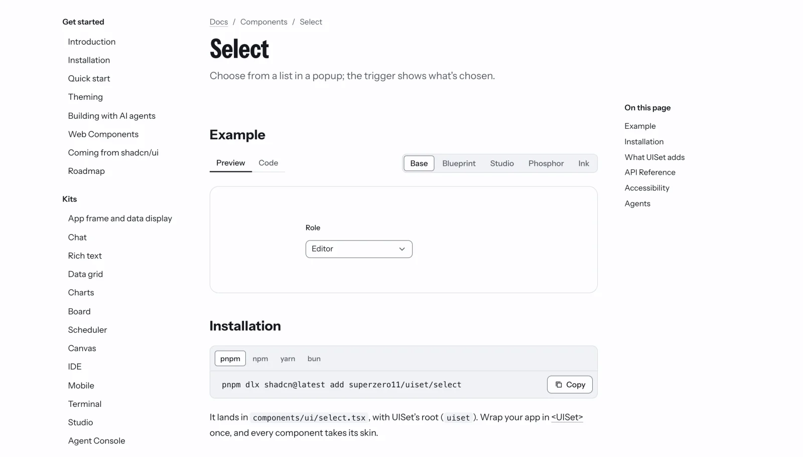</a>
</p>

Each of the 55 components has a page with a live example in every skin, its code, the install
command, UI SDK's API reference and keyboard behavior, and what an agent reads from it. Each
kit and skin has a guide. Every page is also plain Markdown, for agents and for reading here:
start at [the introduction](https://uiset.dev/docs), or browse [docs/](docs/README.md).

## Templates

<p align="center">
  <a href="https://uiset.dev/templates?template=dashboard">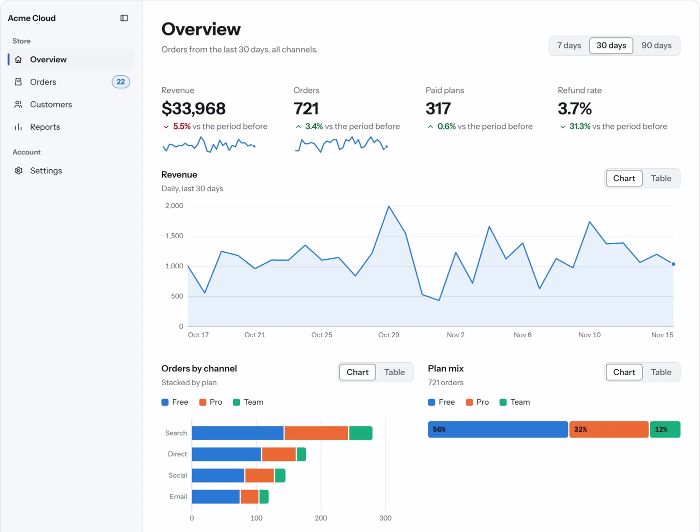</a>
</p>

Whole pages built only from UISet items: **auth, dashboard, settings, admin, inbox, chat app,
project board, calendar, pricing and IDE**. Install one, render it, and swap the sample data
for yours.

```bash
npx shadcn@latest add @uiset/dashboard
```

## React, or anything that renders HTML

Every kit and template also ships as Web Components with the same styles and behavior, for
Vue, Svelte, Solid, Angular and plain HTML. See the
[Web Components guide](https://uiset.dev/docs/web-components); the package is
[@uiset/web](https://www.npmjs.com/package/@uiset/web) on npm.

```bash
npm install @uiset/web @ui-sdk/web
```

```html
<script type="module">
  import "@uiset/web"
</script>

<uiset-root skin="ink">
  <uiset-rich-text label="Release notes" value="## Release 2.4"></uiset-rich-text>
</uiset-root>
```

## Tested like the infrastructure it is

A UI library is only as good as its worst state. These run before every change:

- **Accessibility:** every component, kit and template is checked with axe in every skin
  and theme: text contrast, control edges, names and roles.
- **Three browsers:** the same tests in Chrome, Safari (WebKit) and Firefox.
- **Keyboard:** each kit is driven by keyboard in its tests, focus included.
- **Agents:** each kit has a test where an agent reads it and acts through UI SDK's bridge.
- **Mutation checks:** each new behavior is broken on purpose to prove a test notices.
- **Installs:** every item is installed on its own and all together into a fresh app, then
  type-checked and built, from the live registry too.
- **The rest:** right-to-left, Windows high contrast, reduced motion, phone widths, and React
  and web versions side by side.

## Where it's going

UISet grows with UI SDK, in the open ([roadmap](https://uiset.dev/docs/roadmap)):

- **More skins:** Cockpit, Paper and Print, each with its own sound.
- **Framework guides:** step-by-step setups for Vue, Svelte, Solid and Angular with the Web
  Components build.
- **More templates:** onboarding, a settings console wired for agents, and a docs site.
- **Following UI SDK:** tracking its releases, and reporting what we find upstream, until 1.0.

## Develop

```bash
pnpm install
pnpm exec playwright install chromium webkit firefox
pnpm dev            # the site at http://localhost:5620
pnpm check          # typecheck, unit tests, browser tests
pnpm registry:build # registry.json, public/r, the docs and llms.txt
scripts/install-test.sh
```

[CONTRIBUTING.md](CONTRIBUTING.md) has the rules and what a pull request needs, and
the [roadmap](docs/roadmap.md) the plan; [HISTORY.md](HISTORY.md) has the decisions behind it. Report security issues
privately ([SECURITY.md](SECURITY.md)). Everyone taking part follows the
[code of conduct](CODE_OF_CONDUCT.md).

## Versioning

UISet follows UI SDK's beta. Each release pins exact `@ui-sdk/*` versions (now
`0.1.0-beta.14`), and moves to a new beta once the whole suite passes on it. Until UI SDK
1.0, a minor release of UISet may change an API, and the [changelog](CHANGELOG.md) says what
to do. Registry items are source in your app: to take a release, add them again and review
the diff.

## License

MIT. Built on [UI SDK](https://ui-sdk.dev) by Vercel Labs. UISet is a community project, not
affiliated with Vercel.
